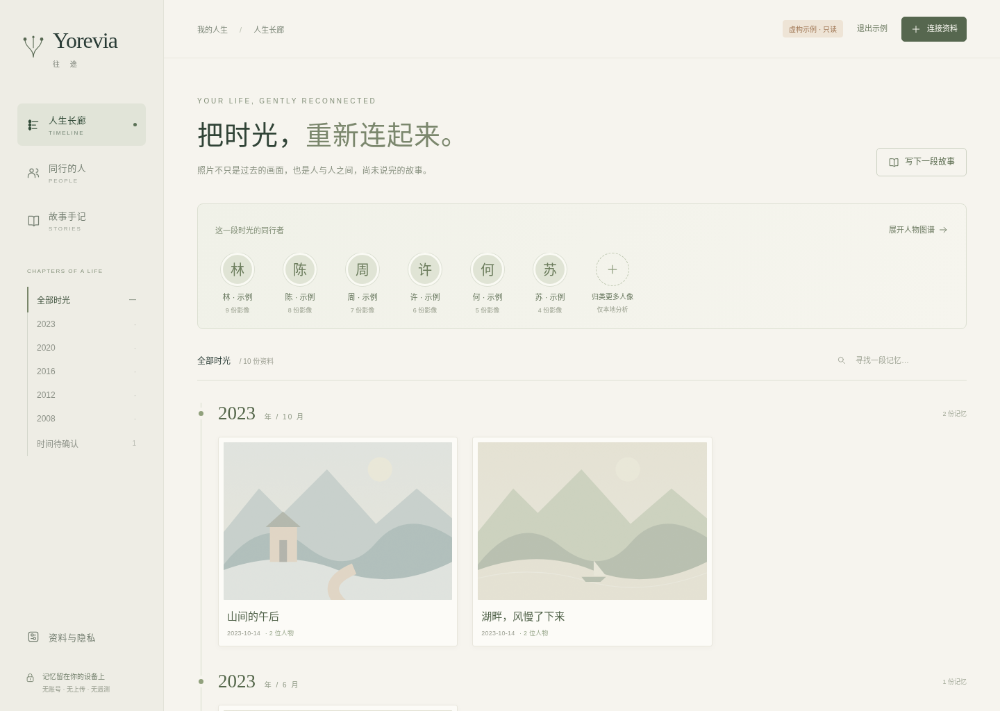

<div align="center">

# Yorevia

**A private atlas of your life.**

English · [简体中文](README.zh-CN.md)

</div>



## Start with the memories you already have

Choose a folder of photos, videos, or text files and build a life timeline without moving your originals or starting from a blank journal. See who appears together in your photos, name people yourself, and add a story when a memory comes back. Yorevia won’t infer real relationships or decide that someone has left your life.

- **Life timeline:** Browse by year and month, search stories, and see which dates are estimated.
- **People and relationships:** Opt in to on-device face grouping, correct groups by hand, and distinguish photo co-occurrence from relationships you confirm.
- **Your files stay yours:** No account, telemetry, or upload for local workflows. Export a portable ZIP with Markdown, JSON, thumbnails, and an offline HTML storybook.

## Run Yorevia in your browser

Yorevia is a **local web app**, not a website hosting your data. A small Python service runs on your computer at `http://127.0.0.1:4173`. Open that address in your browser, choose a local vault once, and Yorevia reopens it when the service restarts. Do not expose or port-forward the listener.

With Python 3.12 and Node.js 22 installed:

```sh
python -m venv .venv
# Activate the venv, or invoke its Python directly.
python -m pip install -r requirements.txt
npm ci
npm run build
python scripts/launch_local_web.py
```

On Linux, the [local Web guide](docs/LOCAL-WEB.md) explains how to add a clickable application shortcut and optional login startup. macOS and Windows use the local browser workflow from source; the project is no longer producing standalone Mac or Windows installers. Historical desktop code and [test records](docs/NATIVE-VALIDATION-2026-11-15.md) are retained for reference, not as current release instructions.

Optional **Baidu Netdisk** indexes supported cloud photos recursively under a selected folder and fetches previews only as needed, without bulk-downloading originals. This preview does not persist your Baidu sign-in. Real provider acceptance is separate from simulated test results.

## Develop

```sh
python -m pip install -r requirements-dev.txt
npm ci
npm run check
npm run build
npm test
python -m pytest -q
```

The [architecture notes](docs/ARCHITECTURE.md) describe the TypeScript browser UI and local Python/SQLite data model. To prepare optional face-analysis models explicitly, run `python scripts/fetch_models.py`. It verifies fixed upstream digests and keeps model licences. Face analysis is opt-in and runs locally.

## Ownership and limitations

The local SQLite database is authoritative; portable exports are readable snapshots, not restorable full backups. Keep active vaults on a local disk and back up only after closing the application. The vault is **not encrypted**. All source media, names, face vectors and written stories remain sensitive. A missing person in later photos is not evidence that a relationship ended.

The supplied single-file visual demo uses fictional data and original abstract artwork. It cannot import files or use the local service.

Source licence: Apache-2.0. Third-party model/runtime/codec licences are separate; see [THIRD_PARTY_NOTICES.md](THIRD_PARTY_NOTICES.md).
