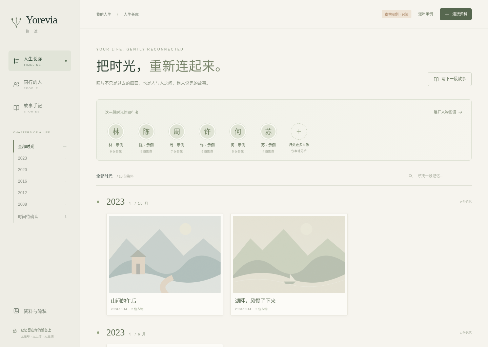

<div align="center">

# Yorevia · 往途

**把散落的记忆，重新连成来时的路。**

Local-first · Open source · Your memories, your files

[English](README.md) · 简体中文 · [本地网页版说明](docs/本地网页版-试用说明.md) · [架构](docs/ARCHITECTURE.md)

</div>



> **0.1 Alpha：本地网页版是默认方式。** 不再构建或发布独立 macOS / Windows 安装包；既有原生源码与历史验证记录保留。

## 一个不要求你从空白页开始的人生档案

选择已有的照片、视频和文字文件夹，不搬迁原件，也不用注册账号。先看到自己的时间轴，再在某张旧照片唤起记忆时补上故事。

照片里的人在本机归类；名字由你填写。同框关系来自照片证据，“朋友”“同事”“家人”等真实关系由你确认，并可以记录起止日期。影像中没有再出现的人，不会被系统判定为已经离开你的生活。

### 此版本实现什么

| 功能 | 当前范围 |
|---|---|
| 人生长廊 | 年份筛选、月份分组、分页、标题/文字/故事搜索，未知日期单独显示 |
| 原件只读 | 本地文件夹；不改写、搬迁或删除原件。百度网盘支持选目录递归索引照片、按需读取预览，不批量下载原片 |
| 稳定关联 | 完整 SHA-256 内容标识；重复文件不重复建档，改名/移动后重新扫描可重连 |
| 时间来源 | EXIF 原始拍摄时间优先；文件名日期明确标记为推测；不把文件修改时间当成事件日期 |
| 同行的人 | YuNet + SFace 本地检测/特征/保守归类，命名、合并、单张人像拆分 |
| 时光人物图谱 | 随年份筛选人物，区分自动同框证据和人工真实关系；画布最多显示 24 人 |
| 故事手记 | 纯文字故事也可以存在；可绑定照片和人物；保留原文，不让模型自动改写 |
| 导出 | ZIP 内含 Markdown、JSON、缩略图和可离线阅读/打印的 HTML 故事册 |
| 隐私控制 | 不上传、不遥测、不自动下载模型；人像分析需确认；可以删除人脸特征和头像缓存 |

**不是本版能力：** 视频内人像识别、跨年龄准确识别保证、自动判断社交关系、面向普通用户的网盘一键登录、云同步冲突合并、地图、AI 传记生成、EPUB/Word 自动排版、加密资料库、已签名安装包。

## 先看界面，不读取任何私人资料

源代码交付 ZIP 附有 `Yorevia-visual-demo.html`，直接在浏览器打开。它使用本项目真实前端和明确标记的虚构示例数据，不包含真人照片，也不会访问你的文件。它是**只读视觉示例**，不连接本地服务。

从 Git 源码生成同一个示例：

```sh
npm install
npm run build
python scripts/make_standalone_demo.py
```

## 运行本地网页版

Yorevia 不托管你的资料。Python 服务只在本机监听，浏览器打开 `http://127.0.0.1:4173`。首次用系统窗口选资料库，重启后自动恢复；**不要将端口转发到公网**。

环境：Python 3.12、Node.js 22。从源码启动：

```sh
python -m venv .venv
# macOS / Linux: source .venv/bin/activate
# Windows PowerShell: .venv\Scripts\Activate.ps1
python -m pip install -r requirements.txt
npm ci
npm run build
python scripts/launch_local_web.py
```

如果 PowerShell 不允许激活虚拟环境，可用 `.venv\Scripts\python.exe` 直接执行 Python 命令，无需改系统策略。Linux 可在一次配置后通过应用菜单或登录自启打开，见[使用指南](docs/LOCAL-WEB.md)。macOS 和 Windows 暂不提供新的独立安装包。百度网盘登录暂不跨重启保留，真实网盘与浏览器验收状态以检测记录为准。

### 开启真实本地人像分析

第一次准备源码开发环境时显式获取官方模型；运行中的应用不会下载或上传资料：

```sh
python scripts/fetch_models.py
```

脚本从 OpenCV 官方仓库下载两个模型，逐字节校验 SHA-256，并保留上游许可文件。下载需要网络；照片分析在本地完成。随后在应用中点击“开始本地人像分析”并确认。

不能联网的电脑可由另一台电脑运行上述脚本，再把完整 `models/` 复制过去。不要替换为来历不明的同名模型。模型未准备好时，时间轴与故事功能仍然可用。

## 数据属于谁？

全部属于你。原件留在来源目录。你选定位置下的 `YoreviaVault/` 保存数据库、缩略图、人脸特征和故事。**它目前不是加密数据库**：能访问你的系统账户或磁盘的人可能读取这些内容。本地优先不等于绝对安全。

**不要把正在使用的 SQLite 资料库放到 NAS 或同步盘中由多台设备同时打开。** 原始资料可以位于可访问的文件夹；活动资料库应位于本机磁盘。关闭应用后再完整备份，或导出便携快照。不要仅复制仍在写入的 `vault.sqlite`。

当前 SQLite 是权威数据源，Markdown/JSON 是导出快照，不是双向同步数据库。导出包不含原片和人脸向量，但含私人故事、人物称呼和缩略图，仍须谨慎分享。详细边界见 [隐私与安全](SECURITY.md)。

## 验证与贡献

```sh
npm run build
npm test
python -m pytest -q
# 可选：已安装 Playwright 和 Chromium 后，执行真实界面 + Python 服务测试
python scripts/check_local_web_browser.py
```

真实模型测试缺少权重时会明确跳过；可用 `YOREVIA_REQUIRE_MODELS=1` 要求模型可运行。测试中的伪造向量仅用于验证聚类流程，不表示真人识别效果。

阅读 [本地网页版指南](docs/LOCAL-WEB.md)、[路线与验收标准](docs/ROADMAP.md) 和 [贡献说明](CONTRIBUTING.md)。

## 许可证

Yorevia 自有源码：Apache-2.0。第三方运行库、解码器和模型适用各自许可证，详见 [THIRD_PARTY_NOTICES.md](THIRD_PARTY_NOTICES.md)。开源代码许可不等于照片人物的隐私授权，也不等于所有模型/编解码器在所有地区的商业许可。
